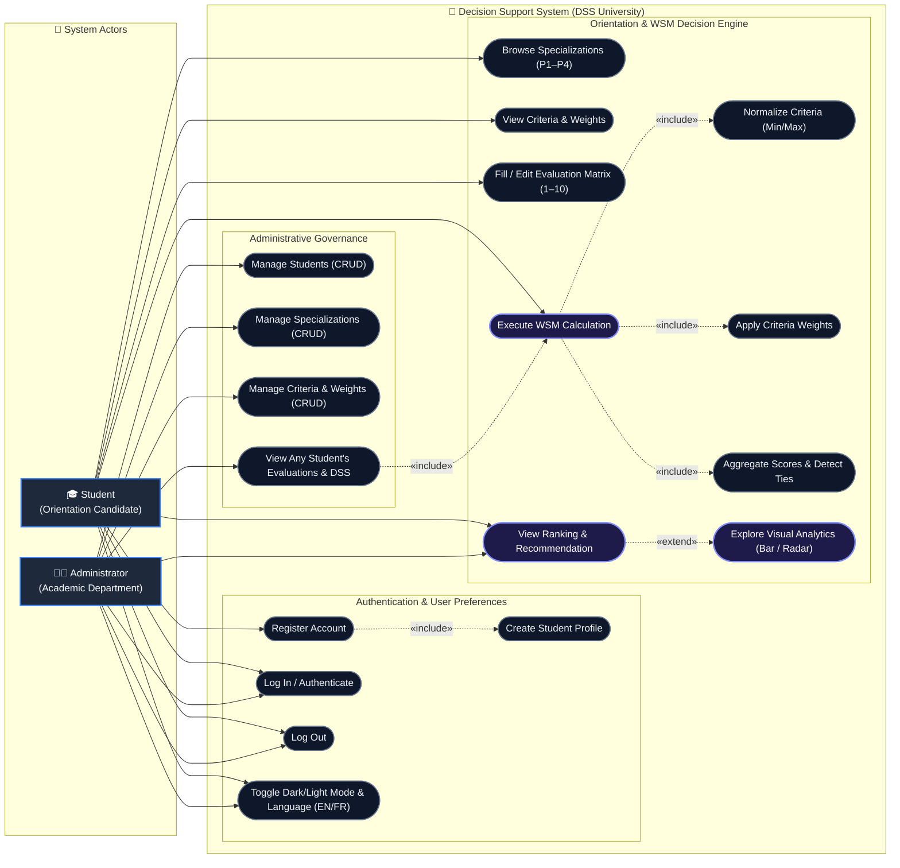

# Decision Support System for University Specialization Selection
**University of Guelma — Department of Computer Science**  
**Module:** Decision Support Systems (DSS)  
**Final Practical Project (3rd Year ISIL - Academic Year 2025/2026)**

---

## 📌 Project Overview

Choosing a university specialization is a multi-criteria decision-making problem. This application is a web-based **Decision Support System (DSS)** that evaluates, ranks, and recommends university specializations for students using the **Weighted Sum Model (WSM)**.

### Features
- **Student Management:** Profiles, roles (Admin / Student), and accounts.
- **Specialization Management:** Codes (P1–P4), bilingual names (EN/FR), descriptions.
- **Criteria & Weighting:** Optimization direction (Maximize/Minimize) and weight configuration (sum = 1.00).
- **Evaluation Matrix:** Evaluation of specializations on a 1–10 scale.
- **Weighted Sum Model Engine:** Dynamic column min/max normalization, criteria weighting, tie detection, and ranking.
- **Visual Analytics:** Interactive Chart.js score bar charts and criteria radar comparison charts.
- **Bilingual Interface:** Instant EN/FR toggle with zero page reloads.
- **Dark Mode First:** Sleek, high-contrast, data-dashboard aesthetic.

---

## 🎯 UML Use Case Diagram

The system models two primary actors: **Student** (the decision maker seeking orientation) and **Administrator** (the academic department managing parameters, tracks, and student cohorts).



### 👥 System Actors

| Actor | Type | Description |
|---|---|---|
| **Student** | Human / Primary | High-school graduate or 3rd-year undergraduate student. Evaluates specializations against decision criteria, computes scores, and consults recommendations. |
| **Administrator** | Human / Secondary | Department chair or academic advisor. Configures criteria weights ($\sum w_j = 1.00$), defines optimization directions (maximize/minimize), curates programs, and supervises student evaluations. |

### 📋 Use Case Specifications

| ID | Use Case Name | Primary Actor | Description | Relationships |
|---|---|---|---|---|
| **UC01** | Register Account | Student | Creates a new user credential and auto-links a student profile record. | `<<include>>` UC02 (Create Student Profile) |
| **UC02** | Create Student Profile | System | Generates a student entity (`first_name`, `last_name`, `email`) associated with the user account. | Included by UC01 |
| **UC03** | Authenticate / Log In | Student, Admin | Verifies bcrypt-hashed credentials and initializes user session with role permissions. | — |
| **UC04** | Toggle Preferences | Student, Admin | Switches UI language between English and French; toggles light/dark theme. | — |
| **UC05** | Browse Specializations | Student, Admin | Views curriculum objectives, codes (P1–P4), and bilingual program descriptions. | — |
| **UC06** | View Decision Criteria | Student, Admin | Consults criteria definitions, direction (benefit vs. cost), and current relative weights. | — |
| **UC07** | Input / Edit Evaluations | Student | Inputs or updates scores (1.00 to 10.00) for each specialization across all decision criteria. | — |
| **UC08** | Execute WSM Calculation | Student, Admin | Triggers the Weighted Sum Model engine to compute normalized matrix and weighted sums. | `<<include>>` UC09, UC10, UC11 |
| **UC09** | Normalize Decision Matrix | System | Applies column-wise normalization ($r_{ij} = x_{ij}/\max$ for beneficial, $r_{ij} = \min/x_{ij}$ for cost criteria). | Included by UC08 |
| **UC10** | Apply Criteria Weights | System | Multiplies normalized values $r_{ij}$ by criterion weights $w_j$. | Included by UC08 |
| **UC11** | Rank Alternatives & Detect Ties | System | Ranks specializations in descending order, flags the optimal recommendation, and alerts ties. | Included by UC08 |
| **UC12** | View Results & Recommendation | Student, Admin | Displays final ranking table, percentage scores, and highlighted top recommendation. | `<<extend>>` UC13 |
| **UC13** | Explore Visual Analytics | Student, Admin | Renders dynamic Chart.js visualizations (overall score bar chart & criteria radar comparison). | Extension of UC12 |
| **UC14** | Manage Students | Admin | Performs full CRUD operations on student records and manages account associations. | — |
| **UC15** | Manage Specializations | Admin | Adds, modifies, or deletes academic specializations (P1–Pn). | — |
| **UC16** | Manage Criteria & Weights | Admin | Adds, edits, or deletes criteria; configures optimization directions and ensures $\sum w_j = 1.00$. | — |
| **UC17** | Review Any Student Evaluations | Admin | Selects any enrolled student to inspect their evaluation matrix and run DSS rankings on their behalf. | `<<include>>` UC08 |

---

## 🛠️ Technology Stack

| Layer | Technology |
|---|---|
| **Frontend** | HTML5, Tailwind CSS (CDN), Vanilla ES6+ JavaScript, Chart.js |
| **Backend** | PHP (Native PDO with prepared statements, RESTful JSON APIs) |
| **Database** | MySQL / MariaDB (Relational schema with foreign keys, checks, indexes) |
| **Design Standard** | UI/UX Pro Max Design Tokens (Contrast verified ≥ 4.5:1) |

---

## 📐 Mathematical Formulation (Weighted Sum Model)

Given:
- $m$ specializations $A_i$ ($i = 1, \dots, m$)
- $n$ criteria $C_j$ ($j = 1, \dots, n$)
- Raw performance matrix $X = [x_{ij}]$, where $x_{ij} \in [1, 10]$
- Weight vector $W = (w_1, w_2, \dots, w_n)$ where $\sum_{j=1}^n w_j = 1.00$

### 1. Normalization
Each criterion column is normalized based on its optimization direction:
- **For Maximization criteria (Beneficial):**
  $$r_{ij} = \frac{x_{ij}}{\max_k x_{kj}}$$
- **For Minimization criteria (Cost / Difficulty):**
  $$r_{ij} = \frac{\min_k x_{kj}}{x_{ij}}$$

### 2. Aggregation & Scoring
The overall score $S_i$ for specialization $A_i$ is computed as:
$$S_i = \sum_{j=1}^n w_j \cdot r_{ij}$$

### 3. Ranking & Tie Detection
- Specializations are sorted in descending order of $S_i$.
- If $S_a = S_b$, a **Tie** is flagged and highlighted in the UI and report.
- The highest-scoring specialization is flagged as the **Recommendation**.

---

## 🗄️ Database Schema & Entities

The relational database `dss_university` consists of 5 tables:
1. `users`: Authentication records, password hashes (`PASSWORD_BCRYPT`), and roles (`admin`, `student`).
2. `students`: Student profile details linked to user accounts.
3. `specializations`: Alternatives (P1 AI, P2 Cybersecurity, P3 Data Science, P4 ISSE).
4. `criteria`: Evaluation criteria with type (`maximize`/`minimize`) and weight.
5. `evaluations`: Student scores per specialization and criterion ($1.00 \le \text{score} \le 10.00$).

---

## 🚀 Installation & Getting Started

### Prerequisites
- [XAMPP](https://www.apachefriends.org/) (or any Apache + PHP 8.x + MySQL / MariaDB environment).

### Setup Instructions
1. **Clone the Repository:**
   ```bash
   cd C:/xampp/htdocs
   git clone https://github.com/jalilbeka/TP-FINAL-DSS1.git dss-university
   cd dss-university
   ```

2. **Database Initialization & Seeding:**
   Ensure MySQL is running in XAMPP, then execute the automated seeder script via CLI:
   ```bash
   php database/seed.php
   ```
   *(Alternatively, import `database/schema.sql` via phpMyAdmin or the MySQL CLI).*

3. **Access the Application:**
   Open your browser and navigate to:
   ```text
   http://localhost/dss-university/
   ```

### Default Credentials

| Role | Username | Password | Access Scope |
|---|---|---|---|
| **Admin** | `admin` | `admin123` | Full administrative control (students, specializations, criteria, all evaluations). |
| **Student** | `student` | `student123` | Student dashboard, specialization evaluation matrix, WSM results & analytics. |
